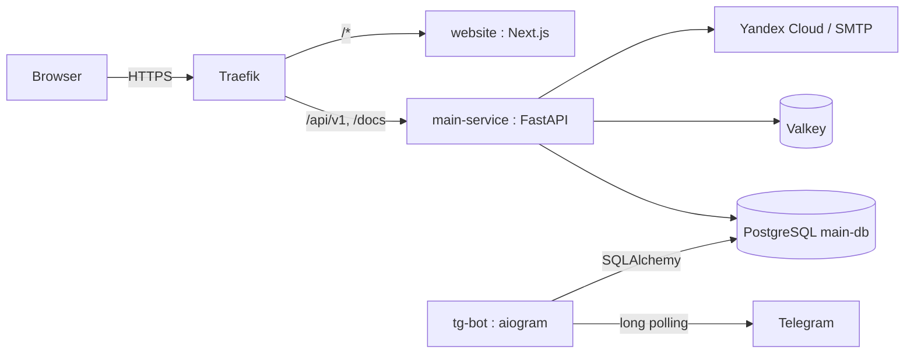

# Architecture

## Services

## Boundaries

- **main-service** — owns `main_db`, runs Alembic migrations, handles all business logic.
- **website** — Next.js. Calls the API via `$fetch` or server-side fetch.
- **tg-bot** — long-polling bot. Talks directly to the DB for reads, calls the API for writes.

## Networks

- **Dev**: `main-network-dev`. Infra in Docker, frontend on host.
- **Prod**: `main-network`. Everything containerised behind Traefik.
