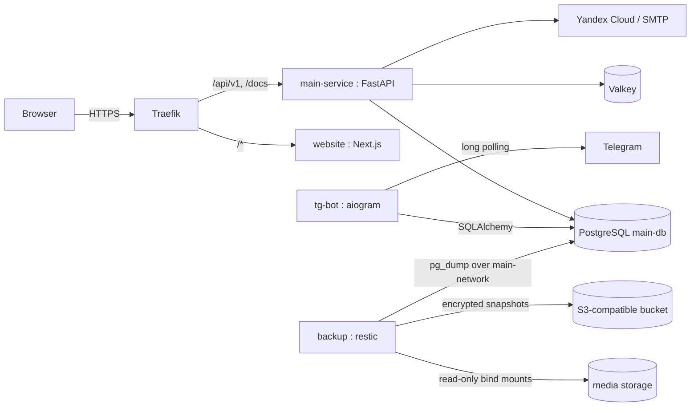

# Architecture

## Services

## Boundaries

- **main-service** — owns `main_db`, runs Alembic migrations, handles all business logic.
- **website** — Next.js. Calls the API via `$fetch` or server-side fetch.
- **tg-bot** — long-polling bot. Talks directly to the DB for reads, calls the API for writes.
- **backup** — separate Compose project in `backup/`. Dumps the DB and reads
  media/config through read-only mounts, then uploads encrypted, deduplicated
  snapshots to S3. It never writes to production data. See
  [`BACKUP.md`](BACKUP.md).

## Networks

- **Dev**: `main-network-dev`. Infra in Docker, frontend on host.
- **Prod**: `main-network`. Everything containerised behind Traefik.
