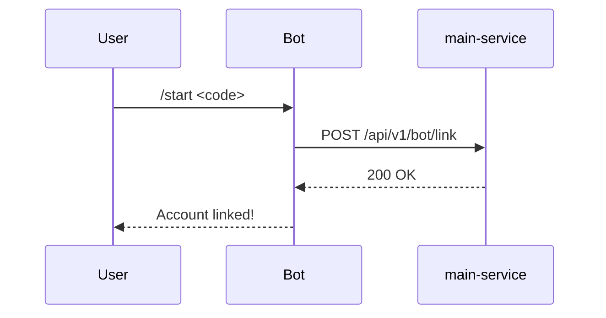

# tg-bot — Spec

Aiogram 3 bot. Long polling.

## Commands

- `/start` — Bind account or show admin menu.
- `/start <code>` — Deep link to bind chat_id to user profile for notifications.
- `/help` — List commands.
- `/search <query>` — Search orders by ID, name, phone, email, telegram.
- `/dump_last <N>` — Export last N orders to Excel.
- `/dump_month <YYYY-MM>` — Export orders for a month to Excel.

## Behaviour

## Env vars

| Var                  | Required | Purpose                                   |
|----------------------|----------|-------------------------------------------|
| `TELEGRAM_BOT_TOKEN` | yes      | from BotFather                            |
| `TELEGRAM_BOT_ALLOWED_USERS` | yes | Comma-separated Telegram user IDs for admin panel |
| `MAIN_DB_*`          | yes      | Postgres connection (for reads)           |
| `MAIN_SERVICE_URL`   | yes      | Backend URL (for writes)                  |
